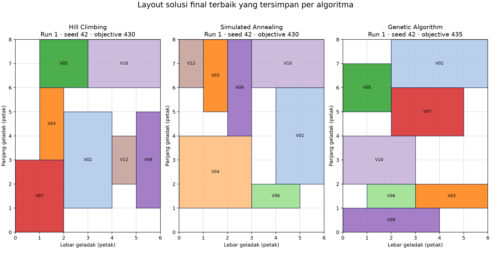

# Laporan Akhir Tugas Besar IF3070 Dasar Inteligensi Artifisial

**Optimasi Penempatan Kendaraan pada Geladak Kapal**

**Kelompok G15 — Munir**

**Anggota:** Ibrahim Ferizarizqi Permana (18224120), Adham Sachadeva Purwadi (18224030), Reyna Athallah Agoes (18224112)

**Versi:** 1.0

**Tanggal penyusunan:** 19 Oktober 2026

> **Status format:** Repository tidak memuat spesifikasi tugas, template laporan, atau ketentuan pengumpulan. Pencarian situs kampus yang tersedia juga tidak menemukan dokumen tugas besar IF3070 yang dapat diverifikasi. Karena itu, dokumen ini memakai struktur laporan akademik umum; format wajib, batas halaman, dan ketentuan pengumpulan masih harus dikonfirmasi kepada pengampu.

## Abstrak

Proyek ini membandingkan tiga metode pencarian untuk menempatkan kendaraan pada geladak kapal dengan tujuan memaksimalkan total shipping fee kendaraan yang berhasil dimuat. Implementasi repository mencakup stochastic Hill Climbing, Simulated Annealing, dan Genetic Algorithm. Laporan menggunakan sembilan run yang telah tersimpan untuk problem berukuran 6 × 8 petak, kapasitas 30, dan 12 kendaraan. Semua solusi akhir yang diperiksa valid. Pada sampel tersebut, Genetic Algorithm memperoleh objective terbaik 435 dan rata-rata objective final 433,33; Simulated Annealing memperoleh rata-rata 428,33; Hill Climbing 423,33. Perbedaan anggaran pencarian, definisi satu langkah, kondisi penghentian, waktu pengukuran, serta tanggal eksekusi membatasi kesimpulan tentang kecepatan dan keunggulan umum. Hasil ini bersifat deskriptif untuk tiga seed, bukan bukti optimalitas global atau signifikansi statistik.

**Kata kunci:** optimasi kombinatorial, penempatan kendaraan, Hill Climbing, Simulated Annealing, Genetic Algorithm.

## 1. Pendahuluan

### 1.1 Latar belakang

Penempatan kendaraan pada geladak merupakan masalah kombinatorial: posisi, orientasi, kendaraan yang dimuat, ruang yang tersedia, dan batas berat saling membatasi. Ruang yang tersedia perlu digunakan untuk memilih himpunan kendaraan dan tata letak yang memberi nilai angkut tinggi tanpa melanggar kelayakan geometris dan kapasitas.

Repository memodelkan nilai kendaraan sebagai `shipping_fee`. Tujuan program adalah memaksimalkan jumlah fee kendaraan yang dimuat. Model ini merupakan abstraksi tugas, bukan simulator operasional kapal: data input tidak memberikan satuan mata uang atau sumber data nyata, dan batasan keselamatan kapal yang lebih luas tidak dimodelkan.

### 1.2 Tujuan dan ruang lingkup

Tujuan laporan adalah menjelaskan formulasi dan mekanisme sesuai kode aktual, merangkum eksperimen tersimpan HC/SA/GA, serta menilai hasil dengan keterbatasannya. Algoritma dan data eksperimen tidak dijalankan ulang untuk laporan ini. Angka dirujuk ke JSON/CSV sumber di `output/`; agregat perbandingan dihitung dari file run yang sama seperti pada analisis Tahap 3. Artefak tersebut tersimpan dalam repository, tetapi tidak ditemukan catatan persetujuan formal atau validasi eksperimen oleh pengampu; laporan ini tidak menyebutnya sebagai hasil yang telah disahkan secara formal.

## 2. Formulasi masalah dan implementasi

### 2.1 Representasi state

Model di `src/munir/core/models.py` berisi `Ship`, `Vehicle`, dan `State`. Kapal memiliki lebar, panjang, dan kapasitas maksimum. Kendaraan memiliki ID, lebar, panjang, shipping fee, berat, ETA, orientasi, dan koordinat `(x, y)`. Koordinat kosong (`None, None`) menandakan kendaraan tidak dimuat. Orientasi horizontal memakai dimensi asli; orientasi vertikal menukar lebar dan panjang yang ditempati.

Secara ringkas, satu solusi menyimpan untuk setiap kendaraan posisi integer pada kisi dan orientasi, atau status tidak dimuat. `State.value` menyimpan hasil evaluasi objective.

### 2.2 Fungsi objektif

`calculate_objective` di `src/munir/core/objective.py` menjumlahkan `shipping_fee` kendaraan yang dapat dimuat: kendaraan harus berada di dalam geladak, tidak bertumpang tindih dengan kendaraan yang telah diterima, dan tidak menyebabkan berat kumulatif melewati kapasitas. Dengan solusi valid, ini setara dengan:

\[
\max \sum_i fee_i \cdot loaded_i
\]

Di dalam fungsi, kendaraan diperiksa mengikuti urutan pada daftar state dan kandidat yang melanggar dilewati. Algoritma HC/SA/GA menjaga atau memperbaiki state agar valid; karena itu angka objective yang dilaporkan harus dibaca bersama pemeriksaan validitas state final. Satuan `shipping_fee` tidak tercantum pada data.

### 2.3 Constraint dan validitas

`src/munir/core/constraints.py` memeriksa empat kondisi:

1. Koordinat kendaraan harus sama-sama kosong atau sama-sama terisi.
2. Kendaraan yang dimuat harus seluruhnya berada di dalam batas geladak.
3. Sel yang ditempati dua kendaraan tidak boleh bertumpang tindih.
4. Jumlah berat kendaraan yang dimuat tidak boleh melebihi kapasitas kapal.

ETA tercatat pada objek kendaraan tetapi tidak dipakai oleh objective maupun pemeriksaan constraint. Model juga tidak memeriksa distribusi beban, stabilitas kapal, jarak aman, jalur akses, lashing, kebakaran, atau urutan bongkar berdasarkan ETA.

### 2.4 Initial state dan operator neighbor

`create_random_initial_state` (`src/munir/core/initial_state.py`) menyalin lalu mengacak urutan kendaraan, memilih orientasi secara acak, dan mengacak posisi kandidat. Kendaraan dimuat bila berat masih di bawah kapasitas dan ditemukan posisi tanpa overlap; bila tidak, kendaraan dibiarkan di luar. Hasil ini menjadi satu initial state untuk HC dan SA. GA membuat populasi dari banyak pemanggilan pembangkit state awal dengan seed turunan.

`random_neighbor` (`src/munir/core/neighbors.py`) memilih salah satu operasi secara acak: memindahkan kendaraan (termasuk mengeluarkannya dengan peluang 0,2), menukar koordinat dua kendaraan, atau memutar orientasi. Kandidat disalin, lalu hanya diterima sebagai neighbor bila lolos validasi. Generator mencoba paling banyak 100 kali sebelum mengembalikan kegagalan.

### 2.5 Algoritma

**Stochastic Hill Climbing (HC).** Pada setiap langkah, algoritma mengambil satu neighbor acak dan menerima hanya bila objective-nya meningkat ketat. Jika tidak ada perbaikan, state sekarang dipertahankan dan penghitung stagnasi bertambah. Run berhenti pada batas iterasi, setelah 150 langkah tanpa perbaikan pada konfigurasi eksperimen ini, atau bila neighbor tidak dapat dibuat. Ini local search satu state [1]; maksimum lokal dan plateau dapat menghentikan pencarian sebelum solusi terbaik yang mungkin ditemukan.

**Simulated Annealing (SA).** Algoritma juga bergerak pada satu state. Neighbor yang tidak lebih buruk diterima; neighbor yang menurunkan objective diterima dengan probabilitas `exp(delta / temperature)` untuk masalah maksimisasi (`delta = candidate - current`). Temperatur dikalikan laju pendinginan sesudah langkah. Implementasi menyimpan lintasan state saat ini dan state terbaik sepanjang pencarian; `final_state` adalah state terbaik, bukan selalu state terakhir lintasan. Pendinginan yang mempertahankan peluang menerima langkah turun merupakan mekanisme klasik simulated annealing [2].

**Genetic Algorithm (GA).** Populasi awal berisi state acak. Setiap generasi mengurutkan populasi, mempertahankan satu elite, memilih parent dengan tournament selection, melakukan crossover per kendaraan (atribut posisi dan orientasi dipilih dari salah satu parent), lalu memperbaiki state yang tidak valid dengan melepas kendaraan yang gagal ditempatkan. Mutasi memanggil operator neighbor dengan probabilitas 0,1. Fitness yang direkam adalah objective maksimum dan rata-rata populasi. Pendekatan populasi dan seleksi/rekombinasi berakar pada literatur algoritma genetika [3].

Deskripsi ini mengikuti implementasi repository (`src/munir/algorithms/`), bukan mengasumsikan variasi standar algoritma yang tidak digunakan kode.

## 3. Rancangan eksperimen

### 3.1 Dataset dan konfigurasi

Problem yang digunakan adalah `configs/problem.adham.json` (6 × 8 petak, kapasitas 30, 12 kendaraan). Nilai fee, berat, ukuran, dan ETA tiap kendaraan terdapat pada file tersebut. Provenance data kendaraan dan satuan nilainya tidak tersedia, sehingga tidak dapat diklaim sebagai data operasional nyata.

Parameter eksperimen yang tersimpan diringkas pada Tabel 1.

**Tabel 1. Konfigurasi eksperimen HC, SA, dan GA.**

| Algoritma | Run | Seed | Batas | Parameter lain |
| --- | ---: | --- | --- | --- |
| HC | 3 | 42, 43, 44 | maks. 1000 iterasi; 150 langkah tanpa perbaikan | `max_no_improvement=150` |
| SA | 3 | 42, 43, 44 | maks. 1000 iterasi; aktual berhenti pada suhu minimum | `T0=60`, `cooling_rate=0.99`, `Tmin=0.1` |
| GA | 3 | 42, 43, 44 | 1000 generasi | populasi 50; mutasi 0.1; elitisme 1; tournament 3 |

Sumber konfigurasi HC/SA adalah `configs/experiment.hc.adham.json` dan `configs/experiment.sa.adham.json`; konfigurasi GA tersimpan di `output/reyna/genetic_algorithm_20261017_210648/config.json`. File JSON run menyimpan seed, objective, iterasi/generasi, waktu, state, dan konfigurasi yang digunakan.

### 3.2 Keterbandingan dan lingkungan

HC dan SA memakai initial state identik untuk masing-masing seed; kesamaan objek `initial_state` diverifikasi pada ketiga pasangan JSON. GA memakai initial population 50 state, sehingga seed sama tidak berarti titik awal atau jumlah kandidat sebanding. HC/SA melaporkan langkah satu lintasan, sedangkan GA melaporkan generasi yang memperbarui populasi; satu generasi GA memproses banyak kandidat. Anggaran evaluasi objective yang setara tidak dicatat dan tidak dapat direkonstruksi tepat dari ringkasan run.

Nilai runtime juga tidak sebanding langsung. Berkas HC/SA berasal dari direktori bertanggal 4 Oktober 2026; direktori GA bertanggal 17 Oktober 2026. Implementasi timer HC dan SA dimulai setelah pembentukan satu initial state, sementara timer GA di runner mencakup pembentukan populasi awal. JSON tidak merekam CPU, sistem operasi, versi Python saat eksperimen, atau kondisi beban mesin. `pyproject.toml` hanya menyatakan syarat Python `>=3.11`; ini bukan bukti versi yang dipakai untuk eksperimen.

## 4. Hasil

### 4.1 Hasil per run

Objective menggunakan unit fee yang tidak disebutkan oleh dataset. Runtime adalah angka yang direkam pada run sumber, dibulatkan enam desimal. Kolom langkah HC/SA dan generasi GA sengaja diberi nama berbeda karena unit pencariannya berbeda.

Hasil tiap run dan seed ditampilkan pada Tabel 2.

**Tabel 2. Hasil individual run dari artefak eksperimen tersimpan.**

| Algoritma | Run | Seed | Objective awal | Objective final terbaik | Durasi (s) | Langkah / generasi | Valid |
| --- | ---: | ---: | ---: | ---: | ---: | ---: | :---: |
| HC | 1 | 42 | 385 | 430 | 0,048424 | 211 iterasi | Ya |
| HC | 2 | 43 | 425 | 425 | 0,030329 | 150 iterasi | Ya |
| HC | 3 | 44 | 415 | 415 | 0,046620 | 150 iterasi | Ya |
| SA | 1 | 42 | 385 | 430 | 0,129901 | 637 iterasi | Ya |
| SA | 2 | 43 | 425 | 430 | 0,133239 | 637 iterasi | Ya |
| SA | 3 | 44 | 415 | 425 | 0,127547 | 637 iterasi | Ya |
| GA | 1 | 42 | 425 | 435 | 306,158083 | 1000 generasi | Ya |
| GA | 2 | 43 | 430 | 430 | 462,771753 | 1000 generasi | Ya |
| GA | 3 | 44 | 435 | 435 | 87,565240 | 1000 generasi | Ya |

Nilai per run berasal dari `run_01.json` sampai `run_03.json` dan dicocokkan dengan `summary.csv` pada direktori eksperimen masing-masing. Validitas dihitung ulang terhadap empat constraint implementasi untuk setiap `final_state`; hasilnya 9 dari 9 valid.

Objective awal GA adalah nilai terbaik dalam populasi awal, sedangkan objective awal HC/SA berasal dari satu initial state. Nilai awal tersebut tidak sepenuhnya sebanding.

### 4.2 Ringkasan perbandingan

Agregat antar-run dirangkum pada Tabel 3.

**Tabel 3. Ringkasan objective, validitas, runtime, dan langkah/generasi.**

| Algoritma | Terbaik | Rata-rata final | Terendah | Valid | Rata-rata runtime (s) | Rata-rata langkah / generasi |
| --- | ---: | ---: | ---: | :---: | ---: | ---: |
| HC | 430 | 423,33 | 415 | 3/3 | 0,041791 | 170,33 iterasi |
| SA | 430 | 428,33 | 425 | 3/3 | 0,130229 | 637 iterasi |
| GA | 435 | 433,33 | 430 | 3/3 | 285,498358 | 1000 generasi |

Rata-rata objective adalah rata-rata **objective final antar-run**. GA juga menyimpan rata-rata fitness populasi, tetapi tidak digunakan sebagai padanan HC/SA: HC/SA merekam satu state, sedangkan GA merekam populasi. Rata-rata runtime hanya menjelaskan run yang tersimpan dan tidak boleh ditafsirkan sebagai perbandingan kecepatan yang adil.

Gambar 1 memperlihatkan perbandingan agregat tersebut; Gambar 2 memperlihatkan layout dari solusi final terbaik yang tercatat untuk tiap metode.

**Gambar 1.** Grafik agregat Tahap 3 dari JSON run tersimpan: rata-rata objective final antar-run dan objective final terbaik tiap metode. Sumber grafik: `docs/assets/tahap_3_algorithm_comparison.png`; data numerik: `docs/tahap_3_comparison.csv`.

**Gambar 2.** Layout final dengan objective tertinggi pada run yang tersedia untuk tiap algoritma: HC run 1/seed 42 (430), SA run 1/seed 42 (430), dan GA run 1/seed 42 (435). Gambar dibuat dari `final_state` JSON sumber dengan generator `scripts/generate_report_solution_comparison.py`. Tiap kotak berlabel ID kendaraan; warna konsisten untuk ID yang sama di seluruh panel dan hanya membedakan kendaraan. Gambar hanya menampilkan kendaraan yang dimuat; kendaraan yang tidak dimuat tetap tercatat pada JSON run.

### 4.3 Konvergensi yang tercatat

Lintasan objektif memberi konteks tambahan, tetapi tidak membuktikan optimum global. HC hanya menerima perbaikan ketat. Run 1 pertama kali mencapai skor final 430 pada iterasi 61; run 2 dan 3 memulai dengan skor yang sama dengan skor final, lalu berhenti setelah 150 langkah sesuai ambang stagnasi. JSON HC tidak menyimpan alasan berhenti secara eksplisit; interpretasi ini mengikuti jumlah iterasi dan kode penghentian.

Semua SA berhenti dengan `stop_reason=min_temperature` pada iterasi 637. Berdasarkan `best_objective_history`, skor final terbaik pertama kali tercapai pada iterasi 298, 213, dan 6 untuk seed 42, 43, dan 44. Lintasan state saat ini dapat menerima gerakan turun, tetapi state terbaik tetap tersimpan.

GA menjalankan seluruh 1000 generasi pada setiap run. Run 1 pertama kali mencapai maksimum akhirnya 435 di generasi 29; run 2 dan 3 telah memulai dengan skor terbaik akhir (430 dan 435). Batas generasi yang tercapai tidak menunjukkan bahwa pencarian telah konvergen atau bahwa tidak ada solusi lebih tinggi.

### 4.4 Interpretasi

Pada tiga seed yang diuji, GA menghasilkan objective terbaik tertinggi (435) dan rata-rata final tertinggi (433,33). SA memiliki rata-rata final 5,00 poin di atas HC dan nilai terendahnya 10 poin lebih tinggi pada sampel ini; keduanya mencapai maksimum 430. Seluruh final state valid.

Perbedaan angka ini hanya menggambarkan konfigurasi dan seed yang tersedia. HC dan SA menjalankan satu lintasan state; GA menggunakan populasi 50 dan 1000 generasi. Angka generasi tidak setara dengan iterasi HC/SA. Sampel tiga run juga terlalu kecil untuk menyimpulkan signifikansi statistik atau performa umum. Objective 435 bukan bukti optimum global.

## 5. Keterbatasan

- Hanya ada tiga run per algoritma dan satu problem; hasil tidak menunjukkan variasi antar problem atau cukup data untuk uji statistik yang kuat.
- Budget komputasi/evaluasi objective tidak dinormalisasi. Ukuran populasi GA membuat jumlah kandidat per generasi berbeda dari satu langkah HC/SA.
- Runtime berasal dari tanggal eksekusi yang berbeda dan timer memiliki cakupan berbeda untuk GA dibanding HC/SA; informasi perangkat dan lingkungan eksperimen tidak direkam.
- Data problem tidak mencatat provenance atau unit fee. ETA tersedia sebagai atribut namun belum berpengaruh pada hasil.
- Model validitas terbatas pada koordinat, batas geladak, overlap, dan kapasitas. Kondisi stabilitas kapal dan aturan operasional nyata berada di luar cakupan.
- Solusi terbaik hanya terbaik di antara hasil eksperimen tersimpan. Tidak tersedia pembanding exact solver atau batas optimum untuk mengukur optimality gap.
- Format laporan, template, dan instruksi pengumpulan resmi belum ditemukan atau dapat diverifikasi.

## 6. Kesimpulan

Stochastic Hill Climbing, Simulated Annealing, dan Genetic Algorithm telah tersedia dan dijalankan pada problem yang sama dengan seed dasar 42 dan tiga run per metode. Sembilan final state tersimpan memenuhi constraint yang diimplementasikan. Genetic Algorithm memberi nilai tertinggi pada eksperimen ini (435; rata-rata 433,33), sedangkan SA memiliki rata-rata final lebih tinggi daripada HC pada tiga seed tersebut. Hasil belum cukup untuk menyatakan GA selalu lebih baik atau lebih cepat karena anggaran pencarian dan pengukuran runtime tidak sebanding. Eksperimen yang lebih kuat memerlukan lebih banyak seed, pencatatan jumlah evaluasi objective, kondisi eksekusi identik, dan model problem dengan provenance serta constraint operasional yang jelas.

## 7. Anggota dan bukti kontribusi

Nama serta NIM di bawah mengikuti identitas yang diberikan untuk proyek. Kontribusi dibatasi pada bukti yang dapat dilihat di riwayat Git dan artefak repository; nama folder saja bukan bukti kepengarangan personal.

Tabel 4 merangkum bukti kontribusi yang dapat diatribusikan dan hal yang masih belum terkonfirmasi.

**Tabel 4. Anggota, bukti repository, dan batas atribusi kontribusi.**

| Anggota | Bukti yang tersedia | Pernyataan kontribusi yang dapat dipertanggungjawabkan |
| --- | --- | --- |
| Ibrahim Ferizarizqi Permana — 18224120 | Riwayat Git oleh `ibr4him-ctrl`: model domain, objective, initial state, constraint, neighbor, GA/HC, runner/interface (commit 859dc5f, b73afb7, a170c92, 419d0da, 147427c, 86c8189; 28 Sep–4 Okt 2026). | Riwayat mendukung kontribusi pada fondasi domain/optimasi dan integrasi algoritma awal. Pembagian kerja di luar commit tersebut tidak diketahui. |
| Adham Sachadeva Purwadi — 18224030 | File konfigurasi bernama `experiment.hc.adham.json` dan `experiment.sa.adham.json`; artefak hasil berada di `output/adham/`. Commit untuk konfigurasi/hasil itu ditulis oleh akun Git `Saka`, bukan nama lengkap anggota yang diberikan. | Artefak berlabel `adham` ada, tetapi pemetaan akun `Saka` ke Adham dan kontribusi individual belum terverifikasi. Perlu konfirmasi anggota. |
| Reyna Athallah Agoes — 18224112 | Riwayat Git oleh `reynaagoes`: integrasi pipeline, hasil GA, dan analisis perbandingan (commit 52602c3, df280ad, 59ace7d; 17–18 Okt 2026). | Riwayat mendukung kontribusi pada pipeline eksperimen, penyimpanan hasil GA, dan analisis Tahap 3. |

Commit hash dan nama akun diperoleh dari `git log`; identitas anggota mengikuti data yang diberikan dalam tugas. Riwayat Git tidak selalu membuktikan seluruh aktivitas kolaborasi atau dokumentasi non-kode.

## Referensi

1. Russell, S. J., & Norvig, P. (2020). *Artificial Intelligence: A Modern Approach* (edisi ke-4). Pearson. [Informasi edisi dari situs penulis](https://aima.eecs.berkeley.edu/translations.html); [katalog Pearson](https://www.pearson.com/en-us/subject-catalog/p/artificial-intelligence-a-modern-approach/P200000003500/9780134610993).
2. Kirkpatrick, S., Gelatt, C. D., Jr., & Vecchi, M. P. (1983). “Optimization by Simulated Annealing.” *Science*, 220(4598), 671–680. [https://doi.org/10.1126/science.220.4598.671](https://doi.org/10.1126/science.220.4598.671).
3. Holland, J. H. (1975). *Adaptation in Natural and Artificial Systems: An Introductory Analysis with Applications to Biology, Control, and Artificial Intelligence*. University of Michigan Press. [Katalog WorldCat edisi 1975](https://search.worldcat.org/title/Adaptation-in-natural-and-artificial-systems-%3A-an-introductory-analysis-with-applications-to-biology-control-and-artificial-intelligence/oclc/1531617); [edisi ulang MIT Press](https://mitpress.mit.edu/9780262581110/adaptation-in-natural-and-artificial-systems/).
4. Implementasi, konfigurasi, dan data eksperimen proyek: `src/munir/`, `configs/experiment.*.json`, `configs/problem.adham.json`, serta JSON/CSV di `output/` sebagaimana dirinci pada Bagian 3–4. Ini merupakan sumber primer untuk angka dan perilaku program dalam laporan.

## Lampiran A — Indeks artefak eksperimen

Tabel 5 menunjukkan lokasi berkas sumber utama untuk angka dan grafik laporan.

**Tabel 5. Indeks artefak eksperimen yang dirujuk.**

| Metode | Konfigurasi / hasil |
| --- | --- |
| HC | `configs/experiment.hc.adham.json`; `output/adham/stochastic_hill_climbing_20261004_194425/{run_01..03.json,summary.csv}` |
| SA | `configs/experiment.sa.adham.json`; `output/adham/simulated_annealing_20261004_194427/{run_01..03.json,summary.csv}` |
| GA | `output/reyna/genetic_algorithm_20261017_210648/{config.json,run_01..03.json,summary.csv,run_*_final.png}` |
| Analisis agregat | `docs/tahap_3_algorithm_comparison.md`, `docs/tahap_3_comparison.csv`, `docs/assets/tahap_3_algorithm_comparison.png` |
