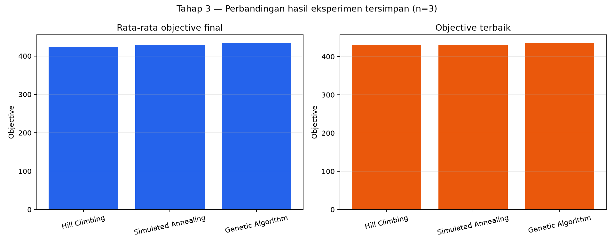

# Tahap 3 — Algorithm Comparison

Perbandingan ini memakai artefak eksperimen yang sudah tersimpan, tanpa menjalankan ulang atau mengubah hasil sumber. Tiga algoritma tersedia dalam `src/munir/algorithms/`: stochastic Hill Climbing, Simulated Annealing, dan Genetic Algorithm.

Sumber data:

| Algoritma | Artefak |
| --- | --- |
| Hill Climbing | `output/adham/stochastic_hill_climbing_20261004_194425` |
| Simulated Annealing | `output/adham/simulated_annealing_20261004_194427` |
| Genetic Algorithm | `output/reyna/genetic_algorithm_20261017_210648` |

## Hasil aktual

Tabel dan grafik berikut dihasilkan ulang dari JSON hasil run oleh `python scripts/generate_algorithm_comparison.py`. Validitas diperiksa ulang dari `final_state` untuk posisi kendaraan, batas geladak, overlap, dan kapasitas.

| Algoritma | Run / seed | Objective terbaik | Rata-rata objective final | Objective final terendah | Solusi valid | Rata-rata runtime (s) | Rata-rata iterasi/generasi |
| --- | --- | ---: | ---: | ---: | ---: | ---: | ---: |
| Hill Climbing | 3 / 42, 43, 44 | 430.00 | 423.33 | 415.00 | 3/3 | 0.041791 | 170.33 |
| Simulated Annealing | 3 / 42, 43, 44 | 430.00 | 428.33 | 425.00 | 3/3 | 0.130229 | 637.00 |
| Genetic Algorithm | 3 / 42, 43, 44 | 435.00 | 433.33 | 430.00 | 3/3 | 285.498358 | 1000.00 |

CSV terstruktur tersedia di `docs/tahap_3_comparison.csv`. Metrik `average_objective` per populasi memang tersimpan untuk GA; HC dan SA hanya menyimpan trajectory dari satu state. Karena maknanya tidak setara, tabel membandingkan **rata-rata objective final antar-run**, bukan menyamakan kedua metrik tersebut.

## Konfigurasi dan keadilan perbandingan

Semua eksperimen memakai problem kapal 6×8, kapasitas 30, dan 12 kendaraan dari `configs/problem.adham.json`; masing-masing tiga run dengan seed dasar 42 sehingga seed run adalah 42, 43, dan 44.

| Algoritma | Batas / penghentian | Parameter khusus |
| --- | --- | --- |
| Hill Climbing | maksimal 1000 iterasi; berhenti setelah 150 tanpa perbaikan | `max_no_improvement=150` |
| Simulated Annealing | maksimal 1000 iterasi; berhenti pada suhu minimum | `T0=60`, cooling rate `0.99`, `Tmin=0.1` |
| Genetic Algorithm | 1000 generasi | populasi 50, mutasi 0.1, elitisme 1, turnamen 3 |

Perbandingan objective dan validitas memakai problem, jumlah run, dan seed yang sama. Namun ini belum merupakan benchmark dengan anggaran komputasi yang identik: GA mengevaluasi populasi 50 pada setiap generasi dan selalu mencapai 1000 generasi, sementara HC/SA adalah pencarian state tunggal dan HC/SA berhenti lebih awal. Selain itu, runtime tersimpan dari eksekusi pada 4 Oktober 2026 (HC/SA) dan 17 Oktober 2026 (GA), sehingga runtime hanya catatan observasi, bukan klaim kecepatan lintas algoritma.

Nilai `initial_objective` GA merepresentasikan anggota populasi awal terbaik, sedangkan HC/SA merepresentasikan satu state awal. Karena definisinya berbeda, metrik tersebut tidak dipakai untuk menentukan pemenang.

## Interpretasi dan keterbatasan

Pada tiga run ini, GA memberikan objective terbaik (435) dan rata-rata final tertinggi (433.33), dengan semua solusi final valid. SA lebih stabil daripada HC pada sampel ini (minimum 425 dibanding 415), dan menyamai best HC (430). Hasil ini bersifat deskriptif untuk tiga seed, bukan bukti signifikansi statistik atau klaim performa runtime.

Keterbatasan utama: sampel hanya tiga run, budget evaluasi tidak disamakan, dan runtime berbeda sesi/lingkungan. Benchmark lanjutan yang adil perlu jumlah evaluasi objective atau batas waktu identik, lebih banyak seed, serta seluruh algoritma dijalankan pada lingkungan yang sama.
